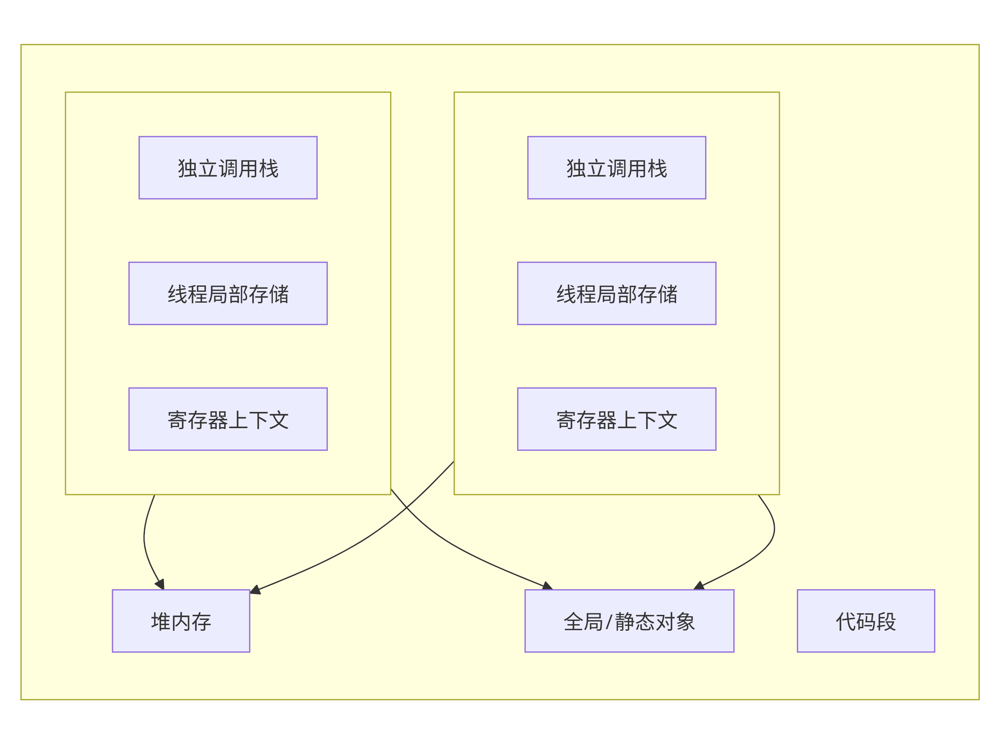
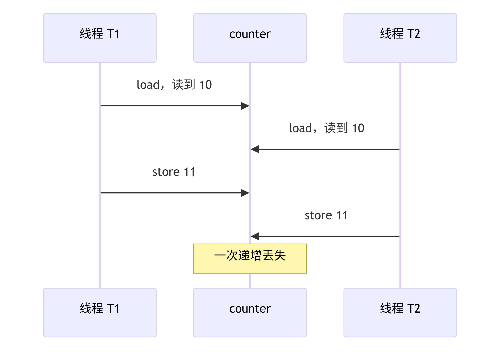
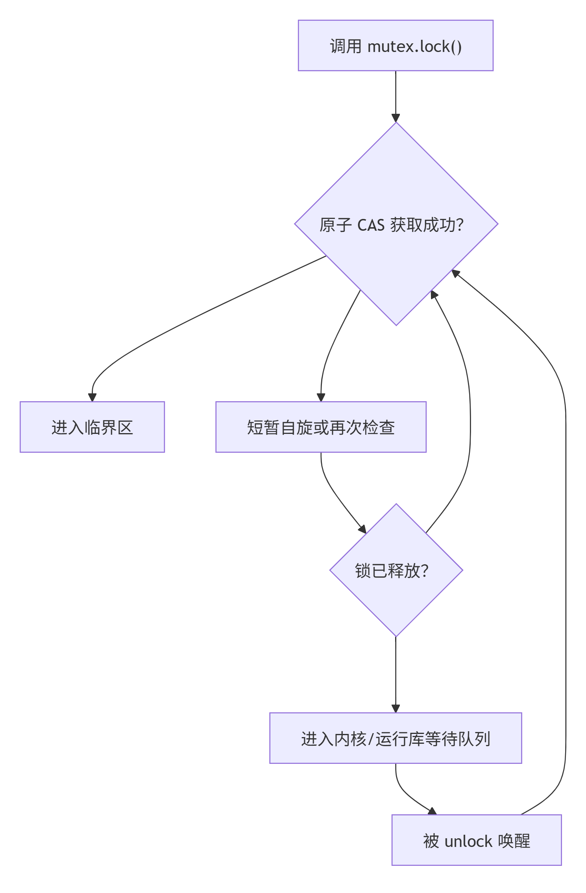
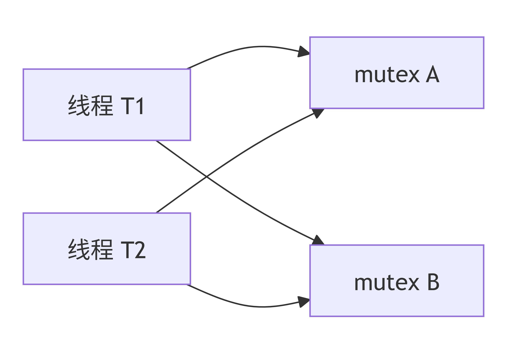
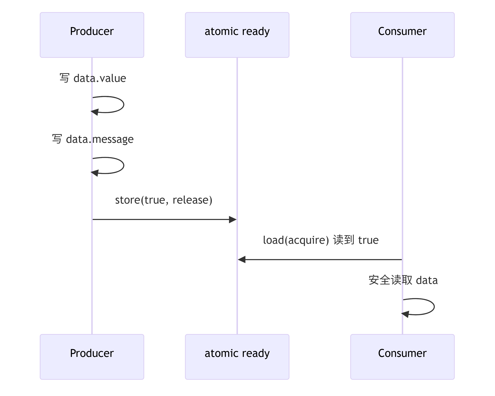
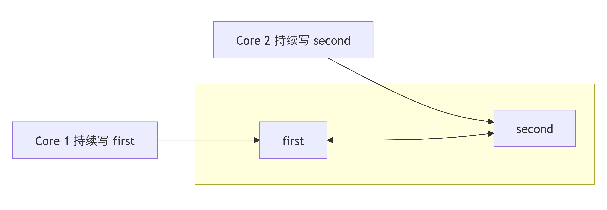

# C++ 并发编程深度指南：从 `std::thread` 到内存模型、线程池与面试实战

> 面向具备 Modern C++ 基础、希望理解并发底层机制和工程实践的中级工程师。\
> 示例默认使用 **C++20**，重点不是“会调用 API”，而是理解 **对象生命周期、同步关系、内存可见性和并发组件边界**。

***

## 1. 先建立正确的并发模型

并发编程最容易犯的错误，是把它理解成“多个函数同时运行”。

真正应关注的是：

1. **谁拥有数据**
2. **谁可以修改数据**
3. **对象活多久**
4. **线程之间通过什么建立 happens-before**
5. **组件停止时，正在运行和尚未运行的任务如何处理**

一个线程本质上是一条独立的执行流。线程可共享进程地址空间，但通常拥有自己的：

* 调用栈；
* 栈指针和寄存器上下文；
* 线程局部存储 TLS；
* 调度状态；
* 操作系统线程标识。



线程可以通过指针或引用访问其他存储期对象；只要两个线程对同一内存位置存在冲突访问，并且没有原子操作或 happens-before 关系，就会形成数据竞争，程序行为未定义。 [\[en.cppreference.com\]](https://en.cppreference.com/cpp/language/multithread)

***

# 2. `std::thread`：线程句柄不是线程本身

## 2.1 创建线程

`std::thread` 是对底层执行线程的 C++ 抽象。它通常保存某种原生线程句柄或线程状态，但其具体内存布局属于实现细节。

```cpp
#include <iostream>
#include <string>
#include <thread>

void worker(int id, std::string message) {
    std::cout << "worker " << id << ": " << message << '\n';
}

int main() {
    std::thread thread{worker, 1, "hello"};
    thread.join();
}
```

构造 `std::thread` 时：

1. callable 和参数被保存到内部状态；
2. 创建新的执行线程；
3. 新线程使用保存的参数调用 callable；
4. 创建者继续执行，不会自动等待。

### 参数默认按值保存

```cpp
#include <functional>
#include <thread>

void increment(int& value) {
    ++value;
}

int main() {
    int value = 0;

    std::thread thread{increment, std::ref(value)};
    thread.join();
}
```

如果没有 `std::ref(value)`，参数会尝试按值传递，无法绑定到 `int&`。

但使用引用时必须保证：

> 被引用对象的生命周期覆盖线程访问它的整个时间窗口。

下面的代码存在悬空引用：

```cpp
#include <thread>

std::thread create_bad_thread() {
    int local = 42;

    return std::thread{[&local] {
        // create_bad_thread 返回后，local 已经销毁。
        // 这里访问的是悬空引用。
        [[maybe_unused]] int value = local;
    }};
}
```

***

## 2.2 `join()`：等待并回收线程执行关系

```cpp
thread.join();
```

`join()` 会阻塞当前线程，直到目标线程执行结束。

从内存模型看，目标线程的完成 **synchronizes-with** `join()` 的成功返回，因此目标线程在结束前的操作，对 `join()` 返回后的当前线程可见。

```cpp
#include <cassert>
#include <thread>

int main() {
    int result = 0;

    std::thread thread{[&result] {
        result = 42;
    }};

    thread.join();

    // 安全：工作线程已经结束，并且 join 建立同步关系。
    assert(result == 42);
}
```

注意：`result` 不是原子变量也没有问题，因为读写并未并发发生；`join()` 建立了顺序关系。

***

## 2.3 `detach()`：只分离所有权，不解决生命周期

```cpp
thread.detach();
```

`detach()` 使 `std::thread` 对象与底层线程分离。分离后：

* 不能再 `join()`；
* 无法直接获取返回值；
* 无法直接传播异常；
* 调用者通常无法可靠控制线程停止；
* 被线程引用的对象仍必须保持有效。

```cpp
#include <chrono>
#include <thread>

void unsafe() {
    int local = 42;

    std::thread thread{[&local] {
        std::this_thread::sleep_for(std::chrono::seconds{1});
        // local 很可能已经销毁。
        ++local;
    }};

    thread.detach();
}
```

`detach()` 往往只是把明显的生命周期问题变成偶发问题。工程中除非线程访问的所有状态都拥有独立、明确且足够长的生命周期，否则不建议使用。

***

## 2.4 忘记 `join()` 或 `detach()` 会怎样

如果一个仍然 `joinable()` 的 `std::thread` 对象被析构，程序会调用 `std::terminate()`。

异常路径特别容易触发这一问题：

```cpp
#include <stdexcept>
#include <thread>

void bad_example() {
    std::thread thread{[] {
        // 执行任务
    }};

    throw std::runtime_error{"operation failed"};

    // 永远执行不到，thread 析构时仍然 joinable。
    thread.join();
}
```

C++20 更推荐 `std::jthread`：

```cpp
#include <stop_token>
#include <thread>

int main() {
    std::jthread worker{std::stop_token stop_token {
        while (!stop_token.stop_requested()) {
            // 执行一小批可中断工作
        }
    }};

    // 析构时请求停止并 join。
}
```

`std::jthread` 的优势是：

* 析构时自动等待；
* 内置协作式停止；
* 更符合 RAII；
* 异常路径安全。

***

# 3. 数据竞争：不是“结果不确定”，而是未定义行为

## 3.1 精确定义

如果两个不同线程的表达式访问同一内存位置，并且：

* 至少一个访问是写；
* 两次访问没有 happens-before 关系；
* 冲突访问不都是原子操作；

则产生 **data race**，程序行为未定义。 [\[en.cppreference.com\]](https://en.cppreference.com/cpp/language/multithread)

```cpp
#include <thread>

int counter = 0;

void increment() {
    for (int i = 0; i < 100'000; ++i) {
        ++counter; // 数据竞争
    }
}

int main() {
    std::thread first{increment};
    std::thread second{increment};

    first.join();
    second.join();
}
```

`++counter` 不是一个不可分割动作，可以抽象为：

```text
load counter
add 1
store counter
```

两个线程可能执行：



但“丢失更新”只是最直观的表现。由于数据竞争属于未定义行为，编译器可基于“合法程序不存在数据竞争”的前提进行优化，最终结果不局限于某几个数值。

***

## 3.2 data race、race condition 和原子性不是同一概念

| 概念             | 含义                       |
| -------------- | ------------------------ |
| Data race      | C++ 内存模型中的冲突访问，通常导致未定义行为 |
| Race condition | 结果依赖线程调度顺序，属于更宽泛的逻辑错误    |
| Atomicity      | 某个操作不可被观察为中间状态           |
| Visibility     | 一个线程的写入何时被另一个线程观察到       |
| Ordering       | 编译器和 CPU 对内存操作可进行何种重排    |

即使完全没有 data race，也可能出现逻辑竞态：

```cpp
#include <atomic>

std::atomic<int> balance{100};

bool withdraw(int amount) {
    // 每一次 load/store 都是原子的，
    // 但“检查余额 + 扣款”整体不是一个原子事务。
    if (balance.load() >= amount) {
        balance.store(balance.load() - amount);
        return true;
    }

    return false;
}
```

***

# 4. `mutex`：保护的是不变量，而不只是变量

## 4.1 基础用法

```cpp
#include <mutex>
#include <thread>
#include <vector>

class Counter {
public:
    void increment() {
        std::lock_guard lock{mutex_};
        ++value_;
    }

    [[nodiscard]] int value() const {
        std::lock_guard lock{mutex_};
        return value_;
    }

private:
    mutable std::mutex mutex_;
    int value_{0};
};
```

同一 mutex 上的 `unlock()` 与后续成功的 `lock()` 建立同步关系；这不仅实现互斥，也让锁内写入对后续持锁线程可见。 [\[cppreference.net\]](https://cppreference.net/cpp/named_req/Mutex.html), [\[en.cppreference.com\]](https://en.cppreference.com/cpp/language/multithread)

***

## 4.2 mutex 的典型底层结构

标准不规定 `std::mutex` 的具体实现，但常见实现具有：

* 用户态锁状态；
* 原子比较交换；
* 等待者计数；
* 竞争严重时使用 OS 等待原语；
* 解锁时唤醒一个或多个等待线程。

典型路径：



因此不能简单地说：

* mutex 一定进入内核；
* atomic 一定比 mutex 快；
* 自旋锁一定更快。

在无竞争或低竞争路径上，mutex 可能只需要少量用户态原子操作；真正昂贵的是高竞争、线程阻塞、唤醒和缓存行迁移。

***

# 5. `lock_guard`、`unique_lock` 与 `scoped_lock`

## 5.1 `std::lock_guard`

适用于整个作用域持续持锁的简单场景：

```cpp
void update() {
    std::lock_guard lock{mutex_};
    // 临界区
}
```

特点：

* 构造时加锁；
* 析构时解锁；
* 不支持手动解锁；
* 语义简单，误用空间小。

***

## 5.2 `std::unique_lock`

适用于：

* 延迟加锁；
* 尝试加锁；
* 条件变量等待；
* 临界区中途解锁；
* 所有权转移。

```cpp
#include <mutex>

std::mutex mutex;

void operation() {
    std::unique_lock lock{mutex, std::defer_lock};

    // 执行无需保护的准备工作

    lock.lock();

    // 修改共享状态

    lock.unlock();

    // 执行耗时操作，不占用锁
}
```

`unique_lock` 通常需要保存：

* mutex 指针；
* 当前是否拥有锁的状态。

因此它比 `lock_guard` 状态更丰富，但更灵活。

***

## 5.3 `std::scoped_lock`：一次锁多个 mutex

```cpp
#include <mutex>

struct Account {
    std::mutex mutex;
    int balance{};
};

void transfer(Account& from, Account& to, int amount) {
    if (&from == &to) {
        return;
    }

    std::scoped_lock lock{from.mutex, to.mutex};

    from.balance -= amount;
    to.balance += amount;
}
```

`std::scoped_lock` 对多个 mutex 使用死锁规避算法，比手动按顺序依次 `lock()` 更安全。

***

# 6. 死锁：四个必要条件与工程规避

经典死锁通常具备：

1. **互斥**：资源不能被同时占用；
2. **持有并等待**：线程持有一个资源，又等待另一个；
3. **不可抢占**：锁不能被外部强制释放；
4. **循环等待**：形成资源等待环。



## 6.1 错误示例

```cpp
#include <mutex>
#include <thread>

std::mutex first_mutex;
std::mutex second_mutex;

void first() {
    std::lock_guard first_lock{first_mutex};
    std::lock_guard second_lock{second_mutex};
}

void second() {
    std::lock_guard second_lock{second_mutex};
    std::lock_guard first_lock{first_mutex};
}
```

## 6.2 避免策略

### 策略一：全局锁顺序

规定所有代码必须按同一顺序获取锁。

```cpp
// 全局规则：永远先锁 A，再锁 B。
std::lock_guard lock_a{mutex_a};
std::lock_guard lock_b{mutex_b};
```

缺点是大型系统中很难维护，特别是在跨模块调用时。

### 策略二：`std::scoped_lock`

```cpp
std::scoped_lock lock{mutex_a, mutex_b};
```

### 策略三：持锁时不调用未知代码

下面的代码危险：

```cpp
void notify_observer() {
    std::lock_guard lock{mutex_};
    observer_->on_changed(); // 未知代码可能重入当前对象
}
```

更好的方式是复制必要状态，然后在锁外调用：

```cpp
void notify_observer() {
    Observer* observer = nullptr;

    {
        std::lock_guard lock{mutex_};
        observer = observer_;
    }

    if (observer != nullptr) {
        observer->on_changed();
    }
}
```

还必须处理 `observer` 生命周期问题；工程中常使用 `shared_ptr`、连接令牌或显式注销协议。

### 策略四：缩小临界区

C++ Core Guidelines 建议最小化可写共享数据、优先基于任务建模，并缩短临界区；同时建议将 mutex 与其保护的数据放在一起。 [\[isocpp.github.io\]](https://isocpp.github.io/CppCoreGuidelines/CppCoreGuidelines), [\[cpp-core-g...vercel.app\]](https://cpp-core-guidelines-docs.vercel.app/concurrency), [\[modernescpp.com\]](https://www.modernescpp.com/index.php/c-core-guidelines-concurrency-and-lock-free-programming/)

```cpp
std::string snapshot;

{
    std::lock_guard lock{mutex_};
    snapshot = shared_state_;
}

// 格式化、日志、I/O 等耗时工作放到锁外。
write_to_disk(snapshot);
```

***

# 7. `condition_variable`：等待“状态”，不是等待“通知”

## 7.1 为什么需要条件变量

轮询会浪费 CPU：

```cpp
while (queue.empty()) {
    // busy waiting，持续消耗 CPU
}
```

条件变量允许线程：

1. 检查共享条件；
2. 条件不满足时，原子地释放 mutex 并阻塞；
3. 被唤醒后重新获取 mutex；
4. 再次检查条件。

```cpp
std::unique_lock lock{mutex_};

condition_.wait(lock, [this] {
    return !queue_.empty();
});
```

等价于概念上的：

```cpp
while (queue_.empty()) {
    condition_.wait(lock);
}
```

***

## 7.2 为什么必须有谓词

原因有两个：

### 虚假唤醒

线程可能在没有相应通知的情况下返回。

### 丢失通知

通知不是持久化消息。如果生产者先调用 `notify_one()`，消费者之后才开始等待，消费者不会自动收到历史通知。

因此必须把真实条件保存在共享状态中：

```cpp
bool ready = false;
```

条件变量只负责提示：

> 状态可能变化了，请重新检查。

***

## 7.3 推荐通知时序

```cpp
{
    std::lock_guard lock{mutex_};
    ready_ = true;
}

condition_.notify_one();
```

通常先解锁再通知，可减少被唤醒线程刚获得调度又因 mutex 未释放而再次阻塞的概率。

但正确性的核心不是通知在锁内还是锁外，而是：

* 条件状态在 mutex 保护下修改；
* 等待方使用同一 mutex 检查谓词；
* 谓词能表达所有退出条件。

***

# 8. 有界生产者—消费者队列

无界队列在压力下可能持续占用内存，因此生产级组件通常需要 **背压**。

```cpp
#include <condition_variable>
#include <cstddef>
#include <deque>
#include <mutex>
#include <optional>
#include <utility>

template <typename T>
class BoundedQueue {
public:
    explicit BoundedQueue(std::size_t capacity)
        : capacity_{capacity} {
        if (capacity_ == 0) {
            throw std::invalid_argument{"capacity must be positive"};
        }
    }

    bool push(T value) {
        std::unique_lock lock{mutex_};

        not_full_.wait(lock, [this] {
            return closed_ || queue_.size() < capacity_;
        });

        if (closed_) {
            return false;
        }

        queue_.push_back(std::move(value));

        lock.unlock();
        not_empty_.notify_one();
        return true;
    }

    std::optional<T> pop() {
        std::unique_lock lock{mutex_};

        not_empty_.wait(lock, [this] {
            return closed_ || !queue_.empty();
        });

        if (queue_.empty()) {
            // closed_ 为 true，且所有已有元素已消费完。
            return std::nullopt;
        }

        T value = std::move(queue_.front());
        queue_.pop_front();

        lock.unlock();
        not_full_.notify_one();
        return value;
    }

    void close() {
        {
            std::lock_guard lock{mutex_};
            closed_ = true;
        }

        // 唤醒所有生产者和消费者，让它们观察 closed_。
        not_empty_.notify_all();
        not_full_.notify_all();
    }

private:
    const std::size_t capacity_;

    std::mutex mutex_;
    std::condition_variable not_empty_;
    std::condition_variable not_full_;

    std::deque<T> queue_;
    bool closed_{false};
};
```

## 8.1 关键不变量

mutex 保护的是以下联合不变量：

```text
0 <= queue.size() <= capacity
closed == true 时不允许再插入
closed && queue.empty() 时消费者退出
```

两个条件变量分别代表：

* `not_empty_`：消费者的等待条件；
* `not_full_`：生产者的等待条件。

## 8.2 为什么 `close()` 必须 `notify_all()`

如果只唤醒一个线程，其余等待线程可能永久睡眠：

* 多个消费者都在等待数据；
* 队列关闭后不会再产生新数据；
* 没有后续通知可以唤醒剩余消费者。

***

# 9. `std::atomic`：原子性不等于事务性

## 9.1 基础计数器

```cpp
#include <atomic>
#include <thread>

std::atomic<std::uint64_t> request_count{0};

void record_request() {
    request_count.fetch_add(1, std::memory_order_relaxed);
}
```

单独计数只需要保证递增不丢失，不需要同步其他数据，因此 `memory_order_relaxed` 通常足够。

***

## 9.2 原子对象可能不是 lock-free

```cpp
std::atomic<long long> value{0};

if (value.is_lock_free()) {
    // 当前对象的操作在该实现上是 lock-free。
}
```

不要假设所有 `std::atomic<T>` 都映射为单条 CPU 原子指令。

具体实现可能：

* 使用原子机器指令；
* 使用循环 CAS；
* 使用内部锁；
* 对类型大小和对齐有额外要求。

`is_always_lock_free` 可查询类型在当前实现上是否总是 lock-free：

```cpp
static_assert(std::atomic<int>::is_always_lock_free);
```

不过该断言并不保证在所有平台上都成立。

***

## 9.3 Compare-And-Swap

```cpp
#include <atomic>

std::atomic<int> maximum{0};

void update_maximum(int candidate) {
    int observed = maximum.load(std::memory_order_relaxed);

    while (observed < candidate &&
           !maximum.compare_exchange_weak(
               observed,
               candidate,
               std::memory_order_relaxed,
               std::memory_order_relaxed)) {
        // 失败时 observed 会被更新为当前实际值。
    }
}
```

`compare_exchange_weak` 可以虚假失败，因此通常用于循环；`compare_exchange_strong` 不允许这种虚假失败，更适合不循环或失败成本较高的场景。

### ABA 问题

CAS 只比较“当前值是否等于预期值”。

如果值经历：

```text
A -> B -> A
```

CAS 无法仅凭值判断它曾经改变过。

常见解决方式：

* 指针加版本号；
* tagged pointer；
* hazard pointer；
* epoch-based reclamation；
* 不立即复用节点地址；
* 使用锁。

无锁数据结构中最难的部分往往不是修改指针，而是 **安全内存回收**。

***

# 10. C++ 内存模型与 memory order

## 10.1 三种核心顺序关系

### Sequenced-before

同一线程内，语言语义规定的求值顺序。

### Synchronizes-with

跨线程同步边，例如：

* release store 与读取到它的 acquire load；
* mutex unlock 与后续成功 lock；
* 线程结束与 `join()` 返回。

### Happens-before

如果 A sequenced-before B，或 A synchronizes-with B，或者通过二者的传递闭包连接，则 A happens-before B。

只要冲突的非原子访问之间存在 happens-before，就不构成数据竞争。

***

## 10.2 各种 memory order

| 内存序       | 原子性 |             约束其他内存操作 | 典型用途              |
| --------- | --: | -------------------: | ----------------- |
| `relaxed` |   是 |                    否 | 独立计数器、统计值         |
| `acquire` |   是 |          禁止后续访问移到它之前 | 消费已发布数据           |
| `release` |   是 |          禁止之前访问移到它之后 | 发布已初始化数据          |
| `acq_rel` |   是 | 同时 acquire 和 release | read-modify-write |
| `seq_cst` |   是 |         最强，并参与单一全局顺序 | 默认、易推理场景          |
| `consume` |   是 |               数据依赖排序 | 实践中避免直接使用         |

`std::memory_order` 不只是控制某个原子变量，也规定原子操作周围普通内存访问的排序约束；默认原子操作使用顺序一致性 `seq_cst`。 [\[en.cppreference.com\]](https://en.cppreference.com/cpp/atomic/memory_order)

***

## 10.3 Release-Acquire 发布模式

```cpp
#include <atomic>
#include <cassert>
#include <string>
#include <thread>

struct Data {
    int value{};
    std::string message;
};

Data data;
std::atomic<bool> ready{false};

void producer() {
    data.value = 42;
    data.message = "initialized";

    ready.store(true, std::memory_order_release);
}

void consumer() {
    while (!ready.load(std::memory_order_acquire)) {
        std::this_thread::yield();
    }

    // acquire 读到了 release 写入的 true。
    // producer 中 release 之前的普通写入现在可见。
    assert(data.value == 42);
    assert(data.message == "initialized");
}
```

同步链：



形式化关系：

```text
写 data
    sequenced-before
release store
    synchronizes-with
acquire load
    sequenced-before
读 data
```

因此：

```text
写 data happens-before 读 data
```

如果双方都使用 `relaxed`，原子 `ready` 本身仍不会数据竞争，但不能借此发布普通对象 `data`。

***

## 10.4 `seq_cst` 不等于“刷新所有缓存”

常见错误解释是：

> `seq_cst` 会把所有 CPU 缓存刷新到内存。

这不准确。

C++ 内存模型描述的是程序可观察的顺序和可见性，不要求某种具体缓存实现。硬件可以使用：

* cache coherence；
* store buffer；
* invalidate queue；
* 内存屏障；
* 带排序语义的原子指令。

`seq_cst` 的关键语义是：

* 具备相应 acquire/release 约束；
* 所有 `seq_cst` 操作还要能放进一个一致的单一全局顺序。

***

## 10.5 何时使用哪种内存序

工程建议：

1. 先使用 mutex、消息传递或默认 `seq_cst` 保证正确；
2. 只有在性能分析证明必要后，再削弱内存序；
3. 每次使用非默认内存序，都写明同步证明；
4. 不要仅凭“x86 上运行正常”判断代码正确；
5. 不要用 `volatile` 做线程同步。

C++ Core Guidelines 明确建议避免数据竞争、最小化显式共享，并且不要使用 `volatile` 进行同步。 [\[cpp-core-g...vercel.app\]](https://cpp-core-guidelines-docs.vercel.app/concurrency)

***

# 11. False Sharing：没有数据竞争，也可能很慢

假设两个线程分别修改两个不同的 atomic：

```cpp
struct Counters {
    std::atomic<std::uint64_t> first{0};
    std::atomic<std::uint64_t> second{0};
};
```

逻辑上互不共享，但二者可能位于同一个 cache line。



于是两个核心反复争夺缓存行所有权，形成 **false sharing**。

可以考虑：

```cpp
#include <atomic>
#include <cstddef>

struct alignas(std::hardware_destructive_interference_size)
AlignedCounter {
    std::atomic<std::uint64_t> value{0};
};

struct Counters {
    AlignedCounter first;
    AlignedCounter second;
};
```

但对齐会增加内存占用，也不保证在所有硬件上取得收益，必须基于 benchmark 和 profiling 决策。

***

# 12. `future`、`promise` 与 `async`

## 12.1 Shared State

`future` 和 `promise` 通常通过一个共享状态通信：


共享状态可能包含：

* 结果对象存储；
* 异常对象；
* ready 标志；
* 等待队列或条件变量；
* 引用计数。

***

## 12.2 `promise`：显式生产结果

```cpp
#include <future>
#include <stdexcept>
#include <thread>

void calculate(std::promise<int> promise) {
    try {
        int result = 21 * 2;
        promise.set_value(result);
    } catch (...) {
        promise.set_exception(std::current_exception());
    }
}

int main() {
    std::promise<int> promise;
    std::future<int> future = promise.get_future();

    std::thread worker{calculate, std::move(promise)};

    const int result = future.get();
    worker.join();
}
```

`future.get()`：

* 等待共享状态就绪；
* 返回结果，或重新抛出工作线程保存的异常；
* 对普通 `future` 通常只能调用一次。

***

## 12.3 `std::async`

```cpp
#include <future>

int calculate() {
    return 42;
}

int main() {
    auto future = std::async(std::launch::async, calculate);
    const int result = future.get();
}
```

不要忽略启动策略：

```cpp
auto future = std::async(
    std::launch::async | std::launch::deferred,
    calculate);
```

实现可以选择：

* `async`：异步执行；
* `deferred`：第一次 `get()` 或 `wait()` 时在等待线程执行。

需要确定并发执行时，应明确指定：

```cpp
std::async(std::launch::async, calculate);
```

但 `std::async` 并不是一个可配置线程池接口：

* 无法规定最大并发度；
* 缺少背压；
* 缺少任务优先级；
* 缺少统一生命周期和监控能力。

***

## 12.4 避免 future 依赖导致线程池饥饿

假设线程池中所有 worker 都执行：

```cpp
auto child = pool.submit(...);
child.get();
```

如果所有 worker 都在等待子任务，而子任务仍在同一队列中，就没有空闲线程执行子任务，形成 **thread-pool starvation deadlock**。

LLVM 的线程池接口也明确警告：任务等待自身、任务组形成依赖环，或所有 worker 都等待尚未得到执行机会的任务，都可能造成死锁。 [\[llvm.org\]](https://llvm.org/doxygen/ThreadPool_8h_source.html), [\[llvm.googl...source.com\]](https://llvm.googlesource.com/llvm-project/llvm/+/refs/heads/master/include/llvm/Support/ThreadPool.h)

常见解决方案：

* worker 等待时帮助执行队列中的任务；
* work stealing；
* 禁止池内同步等待同池任务；
* 区分计算池和阻塞 I/O 池；
* 使用 continuation，而不是 `.get()` 阻塞；
* 建立结构化并发关系。

***

# 13. C++20 线程池实现

下面实现一个具备以下性质的简化线程池：

* 固定 worker 数量；
* `submit()` 返回 `future`；
* 支持异常传播；
* 有界任务队列，实现背压；
* 析构时停止接收任务；
* 处理完已提交任务后退出；
* 使用 `std::jthread` 管理线程生命周期。

```cpp
#include <condition_variable>
#include <cstddef>
#include <functional>
#include <future>
#include <memory>
#include <mutex>
#include <queue>
#include <stdexcept>
#include <thread>
#include <type_traits>
#include <utility>
#include <vector>

class ThreadPool {
public:
    explicit ThreadPool(
        std::size_t worker_count =
            std::max(1U, std::thread::hardware_concurrency()),
        std::size_t queue_capacity = 1024)
        : queue_capacity_{queue_capacity} {
        if (worker_count == 0 || queue_capacity_ == 0) {
            throw std::invalid_argument{
                "worker count and queue capacity must be positive"};
        }

        workers_.reserve(worker_count);

        for (std::size_t i = 0; i < worker_count; ++i) {
            workers_.emplace_back(std::stop_token {
                worker_loop();
            });
        }
    }

    ThreadPool(const ThreadPool&) = delete;
    ThreadPool& operator=(const ThreadPool&) = delete;

    ~ThreadPool() {
        shutdown();
    }

    template <typename Function, typename... Args>
    [[nodiscard]] auto submit(Function&& function, Args&&... args)
        -> std::future<std::invoke_result_t<Function, Args...>> {
        using Result = std::invoke_result_t<Function, Args...>;

        auto task = std::make_shared<std::packaged_task<Result()>>(
            callable = std::forward<Function>(function),
             ... captured_args = std::forward<Args>(args) mutable
                -> Result {
                return std::invoke(
                    std::move(callable),
                    std::move(captured_args)...);
            });

        std::future<Result> future = task->get_future();

        {
            std::unique_lock lock{mutex_};

            not_full_.wait(lock, [this] {
                return stopping_ || tasks_.size() < queue_capacity_;
            });

            if (stopping_) {
                throw std::runtime_error{
                    "cannot submit to a stopped thread pool"};
            }

            tasks_.emplace([task] {
                (*task)();
            });
        }

        not_empty_.notify_one();
        return future;
    }

    void shutdown() noexcept {
        {
            std::lock_guard lock{mutex_};

            if (stopping_) {
                return;
            }

            stopping_ = true;
        }

        not_empty_.notify_all();
        not_full_.notify_all();

        // 显式清空，使 jthread 在函数内部完成 join。
        workers_.clear();
    }

private:
    void worker_loop() {
        while (true) {
            std::function<void()> task;

            {
                std::unique_lock lock{mutex_};

                not_empty_.wait(lock, [this] {
                    return stopping_ || !tasks_.empty();
                });

                if (stopping_ && tasks_.empty()) {
                    return;
                }

                task = std::move(tasks_.front());
                tasks_.pop();
            }

            not_full_.notify_one();

            // packaged_task 会捕获 callable 抛出的异常，
            // 并将其存入对应 future 的共享状态。
            task();
        }
    }

    const std::size_t queue_capacity_;

    std::mutex mutex_;
    std::condition_variable not_empty_;
    std::condition_variable not_full_;
    std::queue<std::function<void()>> tasks_;

    bool stopping_{false};
    std::vector<std::jthread> workers_;
};
```

使用示例：

```cpp
#include <iostream>

int main() {
    ThreadPool pool{4, 128};

    auto first = pool.submit(int lhs, int rhs {
        return lhs + rhs;
    }, 20, 22);

    auto second = pool.submit([] {
        throw std::runtime_error{"task failed"};
        return 0;
    });

    std::cout << first.get() << '\n';

    try {
        [[maybe_unused]] int value = second.get();
    } catch (const std::exception& exception) {
        std::cerr << exception.what() << '\n';
    }
}
```

***

## 13.1 为什么用 `shared_ptr<packaged_task>`

`std::packaged_task` 是 move-only 类型，而 C++20 的 `std::function` 要求保存的 callable 可复制。

因此不能直接把 move-only 的 `packaged_task` 放到 `std::function<void()>` 中。使用 `shared_ptr` 包装后，lambda 变为可复制对象。

可进一步改进为：

* 使用支持 move-only callable 的自定义函数包装器；
* 在 C++23 中使用 `std::move_only_function`；
* 使用类型擦除的任务基类；
* 对小对象进行 inline storage，减少一次堆分配。

***

## 13.2 生产级线程池还需要什么

LLVM 的实现使用共享任务队列、条件变量和 worker 管理，并支持任务组等待；其实现还专门考虑 worker 在等待任务组时协助执行任务，以降低线程池饥饿风险。 [\[llvm.org\]](https://llvm.org/doxygen/ThreadPool_8h_source.html), [\[llvm.org\]](https://llvm.org/doxygen/ThreadPool_8cpp_source.html)

真正生产级线程池通常还需要：

* work stealing；
* 本地队列与全局队列；
* 有界队列和拒绝策略；
* 优雅关闭与立即关闭；
* 任务取消；
* 优先级；
* 队列等待时间监控；
* worker 利用率；
* NUMA/CPU affinity；
* 异常和日志隔离；
* 阻塞任务与计算任务分池；
* 递归提交策略；
* 防止任务依赖环；
* 可测试的调度器接口。

***

# 14. 线程安全设计：从“加锁”提升到“设计不变量”

## 14.1 mutex 与数据放在一起

不推荐：

```cpp
extern std::mutex global_mutex;
extern std::vector<int> global_data;
```

更推荐：

```cpp
#include <mutex>
#include <vector>

class Repository {
public:
    void add(int value) {
        std::lock_guard lock{mutex_};
        values_.push_back(value);
    }

    [[nodiscard]] std::vector<int> snapshot() const {
        std::lock_guard lock{mutex_};
        return values_;
    }

private:
    mutable std::mutex mutex_;
    std::vector<int> values_;
};
```

这使“数据由哪个锁保护”成为类型实现的一部分，而不是依赖外部约定。C++ Core Guidelines 的并发规则也建议将 mutex 与其保护的数据共同定义。 [\[isocpp.github.io\]](https://isocpp.github.io/CppCoreGuidelines/CppCoreGuidelines), [\[modernescpp.com\]](https://www.modernescpp.com/index.php/c-core-guidelines-concurrency-and-lock-free-programming/)

***

## 14.2 不返回受保护对象的裸引用

错误示例：

```cpp
const std::vector<int>& values() const {
    std::lock_guard lock{mutex_};
    return values_;
} // 返回后锁已释放
```

返回引用后，调用者仍可访问容器，但 mutex 已释放。

更安全的方式：

### 快照

```cpp
[[nodiscard]] std::vector<int> snapshot() const {
    std::lock_guard lock{mutex_};
    return values_;
}
```

### 受控回调

```cpp
template <typename Function>
decltype(auto) with_values(Function&& function) const {
    std::lock_guard lock{mutex_};
    return std::invoke(
        std::forward<Function>(function),
        std::as_const(values_));
}
```

不过回调模式要求传入函数：

* 不得长期阻塞；
* 不得重入对象；
* 不得把引用保存到锁外；
* 最好由接口契约明确限制。

***

## 14.3 保护业务不变量

假设：

```cpp
struct State {
    int used;
    int capacity;
};
```

不变量是：

```text
0 <= used <= capacity
```

如果把两个字段分别改成 atomic：

```cpp
std::atomic<int> used;
std::atomic<int> capacity;
```

并不能自然保证跨字段一致性。读线程可能看到来自不同更新时间点的组合。

这时 mutex 更合适：

```cpp
class CapacityState {
public:
    bool reserve(int amount) {
        std::lock_guard lock{mutex_};

        if (amount < 0 || used_ + amount > capacity_) {
            return false;
        }

        used_ += amount;
        return true;
    }

private:
    std::mutex mutex_;
    int used_{0};
    int capacity_{100};
};
```

判断标准不是“变量简单所以用 atomic”，而是：

> 需要维护的是单变量原子状态，还是跨多个字段的业务不变量？

***

## 14.4 优先消息传递和不可变数据

线程安全设计的优先级可以考虑：

1. 不共享；
2. 共享不可变对象；
3. 通过消息传递转移所有权；
4. 使用 mutex 保护复合不变量；
5. 使用 atomic 管理简单状态；
6. 最后才考虑 lock-free 数据结构。

线程不是最佳抽象边界，**任务、队列、actor、future 和不可变快照** 往往更容易推理。C++ Core Guidelines 也建议优先从任务而不是线程的角度设计。 [\[cpp-core-g...vercel.app\]](https://cpp-core-guidelines-docs.vercel.app/concurrency)

***

# 15. 常见并发 Bug 清单

## 15.1 lambda 捕获 `this`

```cpp
void Service::start() {
    worker_ = std::thread{[this] {
        run();
    }};
}
```

必须保证 `Service` 对象在线程结束前不被销毁。

可选策略：

* 析构函数中停止并 join；
* 使用 `std::jthread` 成员；
* `shared_from_this()` 延长生命周期；
* 捕获只读快照而不是 `this`；
* 将线程执行状态放入独立共享 control block。

***

## 15.2 持锁执行 I/O

```cpp
std::lock_guard lock{mutex_};
write_to_network(data_); // 不推荐
```

网络或磁盘 I/O 延迟不可控，会放大锁竞争。

***

## 15.3 在锁内销毁复杂对象

```cpp
{
    std::lock_guard lock{mutex_};
    objects_.erase(iterator);
}
```

被删除对象的析构函数可能：

* 获取其他锁；
* 调用回调；
* 阻塞；
* 重入当前组件。

可以把对象移出容器后在锁外析构：

```cpp
std::shared_ptr<Object> removed;

{
    std::lock_guard lock{mutex_};
    removed = std::move(objects_.at(id));
    objects_.erase(id);
}

// removed 在锁外销毁。
```

***

## 15.4 用 `sleep_for()` 进行线程同步

```cpp
std::this_thread::sleep_for(std::chrono::milliseconds{100});
assert(worker_finished);
```

这是时序假设，不是同步。

应使用：

* `join()`；
* `condition_variable`；
* `future`；
* latch/barrier；
* 原子 `wait/notify`。

***

## 15.5 用 `volatile` 代替 atomic

```cpp
volatile bool stop = false; // 不是线程同步
```

`volatile` 主要用于特殊内存访问语义，不提供 C++ 线程间原子性和 happens-before。

应使用：

```cpp
std::atomic<bool> stop{false};
```

或者更推荐：

```cpp
std::jthread worker{std::stop_token stop_token {
    while (!stop_token.stop_requested()) {
        // 工作
    }
}};
```

***

# 16. 高频面试代码题

## 题目一：两个线程交替打印

```cpp
#include <condition_variable>
#include <iostream>
#include <mutex>
#include <thread>

class AlternatingPrinter {
public:
    void print_odd(int limit) {
        for (int value = 1; value <= limit; value += 2) {
            std::unique_lock lock{mutex_};

            condition_.wait(lock, [this] {
                return odd_turn_;
            });

            std::cout << value << '\n';
            odd_turn_ = false;

            lock.unlock();
            condition_.notify_one();
        }
    }

    void print_even(int limit) {
        for (int value = 2; value <= limit; value += 2) {
            std::unique_lock lock{mutex_};

            condition_.wait(lock, [this] {
                return !odd_turn_;
            });

            std::cout << value << '\n';
            odd_turn_ = true;

            lock.unlock();
            condition_.notify_one();
        }
    }

private:
    std::mutex mutex_;
    std::condition_variable condition_;
    bool odd_turn_{true};
};

int main() {
    AlternatingPrinter printer;

    std::thread odd{&AlternatingPrinter::print_odd, &printer, 10};
    std::thread even{&AlternatingPrinter::print_even, &printer, 10};

    odd.join();
    even.join();
}
```

**面试追问：**

* 为什么 `wait()` 必须使用谓词？
* 为什么 `odd_turn_` 不需要是 atomic？
* `notify_one()` 放在 unlock 前后有什么区别？
* 如果其中一个线程异常退出，另一个线程是否可能永久等待？

***

## 题目二：用 atomic 实现自旋锁

```cpp
#include <atomic>

class SpinLock {
public:
    void lock() noexcept {
        while (flag_.test_and_set(std::memory_order_acquire)) {
            flag_.wait(true, std::memory_order_relaxed);
        }
    }

    void unlock() noexcept {
        flag_.clear(std::memory_order_release);
        flag_.notify_one();
    }

private:
    std::atomic_flag flag_ = ATOMIC_FLAG_INIT;
};
```

这里使用 C++20 `atomic::wait()`，避免纯忙等持续占用 CPU。

**面试重点：**

* `acquire/release` 建立临界区同步；
* spinlock 不可重入；
* 临界区不能阻塞；
* 公平性不确定；
* 高竞争下通常不如成熟 mutex；
* “lock-free 实现的锁”不表示调用者不会等待。

***

## 题目三：无锁单生产者单消费者环形队列

```cpp
#include <array>
#include <atomic>
#include <cstddef>
#include <optional>
#include <utility>

template <typename T, std::size_t Capacity>
class SpscQueue {
    static_assert(Capacity >= 2);

public:
    bool push(T value) {
        const std::size_t tail =
            tail_.load(std::memory_order_relaxed);
        const std::size_t next = increment(tail);

        if (next == head_.load(std::memory_order_acquire)) {
            return false;
        }

        buffer_[tail] = std::move(value);
        tail_.store(next, std::memory_order_release);
        return true;
    }

    std::optional<T> pop() {
        const std::size_t head =
            head_.load(std::memory_order_relaxed);

        if (head == tail_.load(std::memory_order_acquire)) {
            return std::nullopt;
        }

        T value = std::move(buffer_[head]);
        head_.store(increment(head), std::memory_order_release);
        return value;
    }

private:
    static constexpr std::size_t increment(std::size_t index) noexcept {
        return (index + 1) % Capacity;
    }

    std::array<T, Capacity> buffer_{};

    alignas(std::hardware_destructive_interference_size)
        std::atomic<std::size_t> head_{0};

    alignas(std::hardware_destructive_interference_size)
        std::atomic<std::size_t> tail_{0};
};
```

**同步证明：**

* 生产者先写 `buffer_[tail]`；
* 再 release 更新 `tail_`；
* 消费者 acquire 读取新的 `tail_`；
* 因此消费者读取 buffer 时能看到已构造的元素；
* 反方向上，消费者 release 更新 `head_`，生产者 acquire 后才能安全复用槽位。

限制：

* 仅支持单生产者、单消费者；
* 实际容量是 `Capacity - 1`；
* `T` 的异常安全需要进一步定义；
* 泛化为 MPMC 后，不能只增加几个 CAS 就认为正确；
* MPMC 必须处理每个槽位的生命周期、发布状态和内存回收。

***

## 题目四：为什么 double-checked locking 要用 atomic

```cpp
#include <atomic>
#include <memory>
#include <mutex>

class Service {};

std::atomic<Service*> instance{nullptr};
std::mutex instance_mutex;

Service* get_instance() {
    Service* value =
        instance.load(std::memory_order_acquire);

    if (value == nullptr) {
        std::lock_guard lock{instance_mutex};

        value = instance.load(std::memory_order_relaxed);

        if (value == nullptr) {
            value = new Service{};

            instance.store(
                value,
                std::memory_order_release);
        }
    }

    return value;
}
```

release/acquire 防止其他线程看到“指针已经非空，但对象尚未完成初始化”的状态。

不过工程中更应使用：

```cpp
Service& get_instance() {
    static Service instance;
    return instance;
}
```

C++11 起函数局部静态对象的初始化具备线程安全保证，代码更简单，也避免手动管理内存。

***

# 17. 面试中的关键判断题

## atomic 一定比 mutex 快吗？

**不一定。**

需要考虑：

* 竞争程度；
* 缓存行迁移；
* CAS 重试；
* 是否 lock-free；
* 临界区长度；
* 是否维护复合不变量；
* 线程是否会被阻塞；
* 内存序强度；
* false sharing。

***

## `shared_ptr` 是线程安全的吗？

严格说：

* 多个不同的 `shared_ptr` 对象共享同一控制块时，引用计数更新是线程安全的；
* 同一个 `shared_ptr` 对象不能在无同步情况下被多个线程同时修改；
* 被管理对象本身不会因为由 `shared_ptr` 管理而自动线程安全；
* 并发替换共享指针可考虑 `std::atomic<std::shared_ptr<T>>`。

***

## mutex 保护的是代码还是数据？

mutex 最终保护的是：

* 共享状态；
* 该状态上的业务不变量；
* 从检查到修改的完整事务。

“临界区代码”只是访问受保护状态的路径。

***

## 为什么锁内抛异常通常没问题？

如果使用 RAII：

```cpp
std::lock_guard lock{mutex_};
throw std::runtime_error{"failed"};
```

栈展开会调用 `lock_guard` 析构函数并释放 mutex。

但业务状态可能只更新了一部分，所以仍需考虑 **强异常保证** 或事务式更新：

```cpp
State replacement = build_new_state();

{
    std::lock_guard lock{mutex_};
    state_.swap(replacement);
}
```

***

# 18. 工程实践总结

## 推荐原则

1. **优先 `std::jthread`，谨慎使用裸 `std::thread`。**
2. **默认 join，不要把 detach 当作生命周期解决方案。**
3. **通过 RAII 管理锁和线程。**
4. **mutex 与被保护数据共同封装。**
5. **保护业务不变量，而不是机械地保护单个字段。**
6. **条件变量永远配合谓词。**
7. **停止状态必须进入等待谓词。**
8. **生产者—消费者队列应考虑容量与背压。**
9. **atomic 适合简单状态，不等于多字段事务。**
10. **非默认 memory order 必须有同步证明。**
11. **锁内不执行未知回调、I/O 或长耗时计算。**
12. **线程池要处理关闭、异常、队列容量和依赖死锁。**
13. **不要用 `sleep_for()` 验证同步正确性。**
14. **使用 ThreadSanitizer、压力测试和故障注入。**
15. **先正确，后测量，再优化。**

最后应牢记：

> C++ 并发的核心不是让多段代码同时运行，而是让共享状态的所有权、生命周期、原子性、可见性和顺序关系都能够被严格证明。
