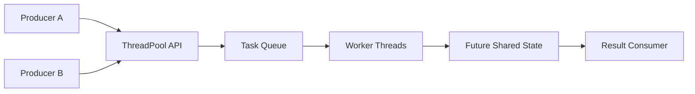
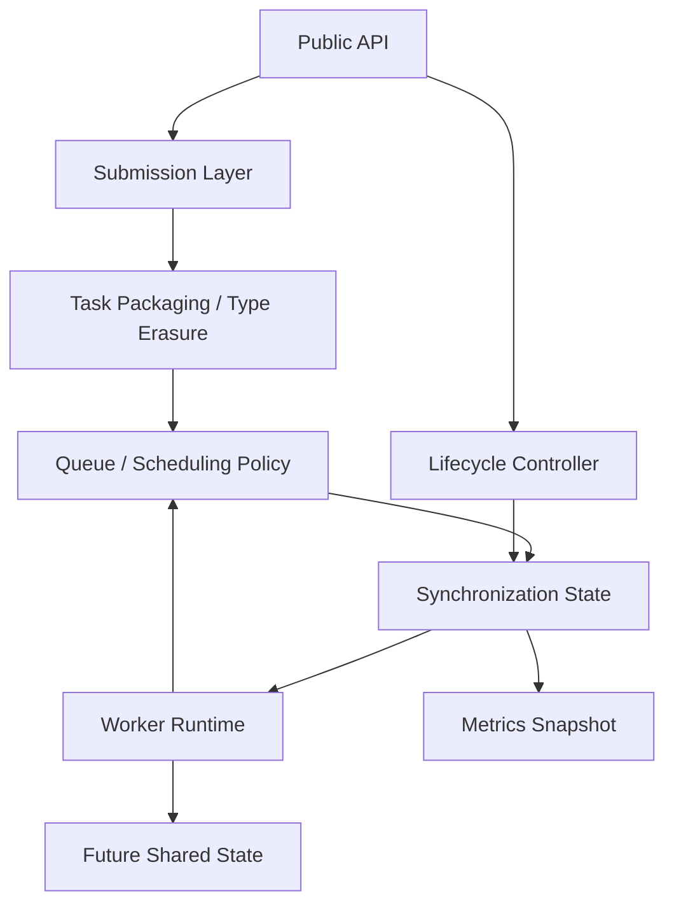
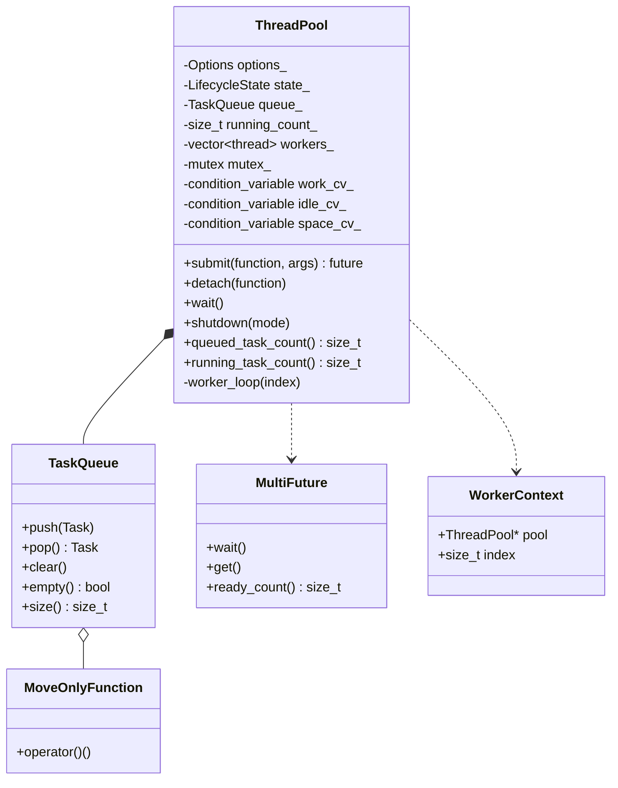
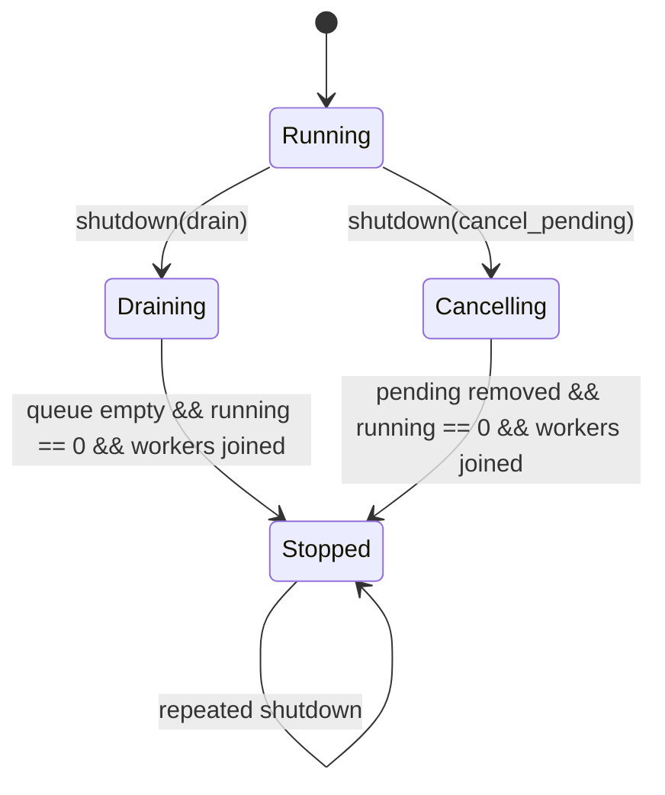
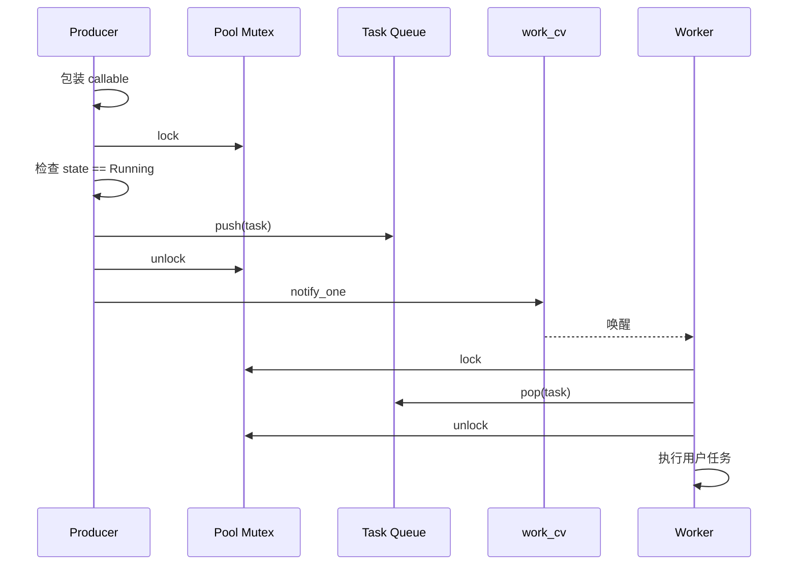
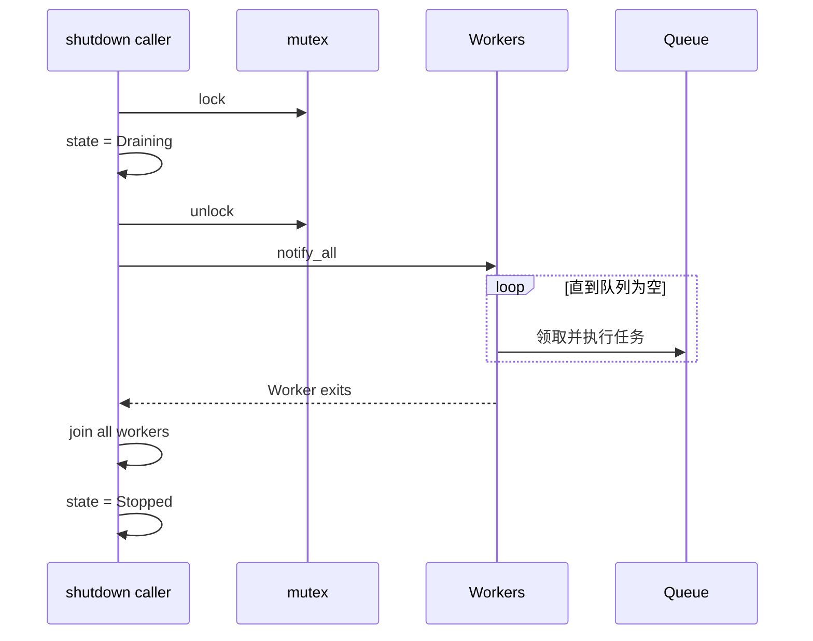

# DannyThreadPool 软件设计说明书（SDD）

**文档编号：** DTP-SDD-001  
**版本：** 0.1.0  
**状态：** Draft  
**对应规格：** DTP-SPEC-001  
**目标标准：** C++20

---

## 1. 文档目的

本文档描述 DannyThreadPool 的体系结构、组件职责、数据结构、同步策略、状态机、核心算法、异常安全、测试设计和演进方案。SPEC 定义外部行为，SDD 解释如何实现这些行为。

## 2. 设计原则

1. **正确性优先于无锁化。** 首版使用 mutex 与 condition variable 建立清晰的 happens-before 关系。
2. **锁保护不变量，而不是孤立变量。** 队列、Running 计数和生命周期状态共同参与等待与关闭条件。
3. **用户代码永远在内部锁外执行。** 避免线程池串行化、重入死锁和不可控锁持有时间。
4. **状态由谓词保存，通知不保存状态。** condition variable 只用于提醒重新检查谓词。
5. **生命周期显式化。** Running、Draining、Cancelling、Stopped 使用明确状态机，而不是多个含义重叠的 bool。
6. **取消是协作式和分层的。** Pending 可移除；Running 只能由任务自行响应停止请求。
7. **先实现共享 FIFO，再扩展策略。** 调度策略不侵入 Worker 生命周期管理。
8. **每项可选功能都应有可测量成本。** 默认路径保持精简。

## 3. 系统上下文



线程池位于任务生产者和执行线程之间。它不拥有用户捕获对象，只拥有排队任务包装及 Worker 生命周期。

## 4. 逻辑架构



### 4.1 Public API

负责参数校验、生命周期检查、返回 Future 和暴露只读监控信息，不直接执行调度循环。

### 4.2 Task Packaging

将任意 callable 和参数转换为统一的零参数任务：

```cpp
using Task = MoveOnlyFunction<void()>;
```

V1/V2 可暂时使用：

```cpp
using Task = std::function<void()>;
```

V3 替换为 move-only 类型擦除，以支持 `std::unique_ptr` 捕获和 `std::packaged_task` 直接入队。

### 4.3 Scheduler

默认 FIFO。后续以策略或条件编译方式扩展 Priority scheduler。Scheduler 只负责 Queued 任务，不执行用户代码。

### 4.4 Lifecycle Controller

负责状态转换、提交门禁、通知 Worker、清理 Pending 任务和 join。

### 4.5 Worker Runtime

每个 Worker 执行相同循环：等待、取任务、更新计数、解锁、执行、更新计数、通知等待者。

## 5. 源码结构

```text
danny-thread-pool/
├── CMakeLists.txt
├── include/dtp/
│   ├── thread_pool.hpp
│   ├── thread_pool_options.hpp
│   ├── task.hpp
│   ├── move_only_function.hpp
│   ├── multi_future.hpp
│   ├── exceptions.hpp
│   └── this_worker.hpp
├── src/
│   └── thread_pool.cpp
├── tests/
│   ├── construction_test.cpp
│   ├── submission_test.cpp
│   ├── future_test.cpp
│   ├── wait_test.cpp
│   ├── shutdown_test.cpp
│   ├── bounded_queue_test.cpp
│   ├── recursive_submit_test.cpp
│   └── stress_test.cpp
├── benchmarks/
│   ├── submission_benchmark.cpp
│   ├── task_granularity_benchmark.cpp
│   └── false_sharing_benchmark.cpp
└── docs/
    ├── SPEC.md
    └── SDD.md
```

学习阶段可以先保持 Header-only；当编译时间或 ABI 稳定性成为问题时，再拆分 `.cpp`。

## 6. 核心类设计



这些是组合关系，不是继承关系。

## 7. 生命周期状态机

```cpp
enum class LifecycleState : std::uint8_t {
    running,
    draining,
    cancelling,
    stopped
};
```



### 7.1 状态含义

| 状态 | 接受新任务 | 执行 Queued | 等待 Running | 可恢复 |
|---|---:|---:|---:|---:|
| Running | 是 | 是 | 不适用 | 是 |
| Draining | 否 | 是 | 是 | 否 |
| Cancelling | 否 | 否，移除 | 是 | 否 |
| Stopped | 否 | 否 | 已完成 | 否 |

`paused` 不并入生命周期枚举，而是单独状态，因为 Pause 可以和 Running 共存，但进入关闭后 Pause 必须被覆盖。

## 8. 共享数据与同步策略

### 8.1 被 `mutex_` 保护的字段

```cpp
LifecycleState state_;
TaskQueue tasks_;
std::size_t running_count_;
bool paused_;
```

任何读取或修改这些字段的路径都必须持有 `mutex_`，除非字段在对象完全构造前或所有 Worker join 后访问。

### 8.2 不需要该 mutex 的字段

```cpp
std::vector<std::thread> workers_;
const ThreadPoolOptions options_;
```

约束：

- `workers_` 只在构造、reset 或 shutdown join 阶段修改；这些操作由生命周期控制串行化。
- 对外 `worker_count()` 在不支持动态 reset 的版本中可无锁读取。

### 8.3 条件变量

| 条件变量 | 等待者 | 谓词 |
|---|---|---|
| `work_cv_` | Worker | 可取任务，或生命周期要求退出 |
| `idle_cv_` | `wait()` 调用者 | `tasks_.empty() && running_count_ == 0` |
| `space_cv_` | 有界队列提交者 | 队列未满，或不再接受任务 |

条件变量可以合并，但独立命名能降低错误唤醒和维护复杂度。

### 8.4 锁顺序

核心版本只有一把内部 mutex，因此没有内部锁顺序环。后续增加 metrics mutex、priority queue 或日志锁时，规则为：

```text
ThreadPool state mutex
    → scheduler-specific mutex
    → metrics mutex
```

禁止持有内部锁调用：

- 用户 callable；
- 用户异常处理器；
- 用户初始化/清理 Hook；
- 阻塞 I/O；
- `future::get()`。

## 9. Worker 算法

### 9.1 等待谓词

概念函数：

```cpp
bool can_worker_proceed() const {
    if (state_ == LifecycleState::cancelling ||
        state_ == LifecycleState::stopped) {
        return true;
    }

    if (state_ == LifecycleState::draining) {
        return !tasks_.empty() || running_count_ == 0;
    }

    return !paused_ && !tasks_.empty();
}
```

实际实现可简化，但必须覆盖：新任务、取消、Drain 完成、关闭覆盖 Pause。

### 9.2 Worker 主循环伪代码

```cpp
void ThreadPool::worker_loop(std::size_t index) noexcept {
    WorkerContextScope context{this, index};
    run_init_hook_without_pool_lock(index);

    while (true) {
        Task task;

        {
            std::unique_lock lock{mutex_};
            work_cv_.wait(lock, [this] {
                return worker_predicate_locked();
            });

            if (should_worker_exit_locked()) {
                break;
            }

            task = tasks_.pop();
            ++running_count_;
            space_cv_.notify_one();
        }

        execute_task_noexcept(task);

        {
            std::lock_guard lock{mutex_};
            --running_count_;

            if (tasks_.empty() && running_count_ == 0) {
                idle_cv_.notify_all();
                work_cv_.notify_all();
            }
        }
    }

    run_cleanup_hook_without_pool_lock(index);
}
```

### 9.3 线性化点

- 提交成功的线性化点：任务成功插入队列且仍处于接受状态的临界区内部。
- Worker 领取任务的线性化点：任务从 Queue 移除并将 `running_count_` 加一的同一临界区。
- `wait()` 完成的线性化观察：持锁观察到 `queue.empty() && running_count_ == 0`。
- 关闭拒绝新任务的线性化点：持锁将状态从 Running 改为 Draining/Cancelling。

## 10. 提交流程



### 10.1 Future 任务

推荐 V2 过渡实现：

```cpp
template <typename Function, typename... Args>
auto ThreadPool::submit(Function&& function, Args&&... args)
    -> std::future<std::invoke_result_t<Function, Args...>> {
    using Result = std::invoke_result_t<Function, Args...>;

    auto packaged = std::make_shared<std::packaged_task<Result()>>(
        [callable = std::forward<Function>(function),
         ... captured = std::forward<Args>(args)]() mutable -> Result {
            return std::invoke(
                std::move(callable),
                std::move(captured)...);
        });

    auto future = packaged->get_future();

    enqueue([packaged] {
        (*packaged)();
    });

    return future;
}
```

V3 改为 `MoveOnlyFunction<void()>` 后，可直接移动 `packaged_task`，从而避免仅为满足 `std::function` 可复制要求而使用 `shared_ptr`。

### 10.2 参数语义

默认将 callable 和参数衰减后按值移动到任务中。引用语义必须显式使用：

```cpp
pool.submit(function, std::ref(object));
```

这是为了避免异步任务无意间持有局部变量悬空引用。

## 11. `wait()` 设计

```cpp
void ThreadPool::wait() {
    reject_if_current_worker_of_this_pool();

    std::unique_lock lock{mutex_};
    idle_cv_.wait(lock, [this] {
        return tasks_.empty() && running_count_ == 0;
    });
}
```

### 11.1 Wait 的边界语义

`wait()` 等待的是动态全局 Idle。如果其他线程在 Wait 期间提交新任务，这些任务也可能纳入当前等待。

如果需要“只等待调用前已提交的任务”，后续应引入 Generation/Ticket：

```text
每个提交获得递增 ticket
wait_until_ticket(snapshot)
```

初版不提供该语义，以避免把任务完成顺序和全局计数混淆。

## 12. 关闭设计

### 12.1 Drain shutdown



### 12.2 Cancel-pending shutdown

步骤：

1. 持锁将状态改为 Cancelling；
2. 将所有 Pending Task 移出队列；
3. 在锁外销毁或取消这些 Task；
4. 唤醒 Worker 和阻塞提交者；
5. 等待 Running 任务自然完成；
6. join Worker；
7. 状态改为 Stopped。

必须在锁外销毁复杂 Task，因为 Task 析构可能触发用户对象析构或 Future 状态变化。

### 12.3 并发 shutdown

增加独立生命周期串行化机制：

```cpp
std::once_flag shutdown_once_;
```

或使用 state + join ownership。推荐使用独立的 `shutdown_mutex_` 串行化 join，因为 `std::call_once` 不适合未来 reset。任何线程都可发起停止，但只有一个非 Worker 调用者执行 join。

## 13. 有界队列设计

### 13.1 Blocking submit

```cpp
std::unique_lock lock{mutex_};
space_cv_.wait(lock, [this] {
    return state_ != LifecycleState::running ||
           tasks_.size() < capacity_;
});

if (state_ != LifecycleState::running) {
    throw pool_stopped{};
}

tasks_.push(std::move(task));
```

Worker pop 后调用 `space_cv_.notify_one()`。关闭时调用 `space_cv_.notify_all()`，避免生产者永久阻塞。

### 13.2 原子批量提交

要实现“全有或全无”，谓词必须等待：

```text
capacity - queue.size >= batch.size
```

若 Batch 大于总容量，则立即失败，不能永久等待。

## 14. 任务取消与 Future 完成

普通 `std::packaged_task` 在未执行即销毁时，其 Future 通常通过 broken-promise 类错误变为就绪，但项目应提供更明确的 `task_cancelled` 语义。

推荐内部任务模型：

```cpp
class ITask {
public:
    virtual ~ITask() = default;
    virtual void run() noexcept = 0;
    virtual void cancel() noexcept = 0;
};
```

Future Task 的 `cancel()` 向共享状态写入 `task_cancelled`；Detached Task 的 `cancel()` 仅释放资源。

若为保持轻量不使用虚函数，可采用 move-only 类型擦除并同时保存 run/cancel 函数指针。

## 15. 优先级调度设计

任务节点：

```cpp
struct ScheduledTask {
    std::int8_t priority;
    std::uint64_t sequence;
    Task task;
};
```

比较规则：

```text
priority 大者先执行；
priority 相同时 sequence 小者先执行。
```

`sequence` 在 mutex 保护下递增，无需 atomic。这样保证同优先级稳定 FIFO。

优先级不能抢占 Running Task，也不提供实时保证。

## 16. Worker 上下文与死锁检测

```cpp
struct WorkerContext {
    ThreadPool* pool{};
    std::size_t index{};
};

inline thread_local WorkerContext* current_worker_context = nullptr;
```

使用 RAII 设置和恢复，以支持线程执行其他环境代码：

```cpp
class WorkerContextScope {
public:
    WorkerContextScope(ThreadPool* pool, std::size_t index);
    ~WorkerContextScope();
};
```

检测规则：

```cpp
if (current_worker_context != nullptr &&
    current_worker_context->pool == this) {
    throw wait_deadlock{};
}
```

应检测：

- `wait()`；
- 同步 `shutdown()`；
- 未来任何等待整个池或包含自身任务组的 API。

注意：这只能检测直接同池等待，不能自动证明任意 Future 依赖图无环。

## 17. 异常处理

### 17.1 Future Task

由 `packaged_task` 或内部 Promise 将异常写入共享状态，Worker 不感知业务异常。

### 17.2 Detached Task

Worker 顶层必须：

```cpp
try {
    task();
} catch (...) {
    report_detached_exception(std::current_exception());
}
```

异常处理器必须在内部锁外调用，并且处理器自身异常必须被吞掉或导致明确的 fail-fast 策略，不能逃出 Worker。

### 17.3 Hook

初始化 Hook 失败时：

- 标记构造失败；
- 请求所有 Worker 停止；
- join 已启动 Worker；
- 构造函数重新抛出聚合或首个异常。

清理 Hook 必须 `noexcept` 语义执行。

## 18. 内存模型说明

核心实现不手写弱内存序，主要同步关系由 mutex 和 condition variable 建立：

```text
Producer 在持锁区 push Task
    → unlock
    → Worker 后续 lock
    → Worker 观察到 Task
```

同一 mutex 上的 unlock 与后续成功 lock 建立同步关系，因此 Task 对象的构造结果对 Worker 可见。

独立统计 若不参与控制流，可使用：

```cpp
std::atomic<std::uint64_t> completed_count{0};
completed_count.fetch_add(1, std::memory_order_relaxed);
```

但 `running_count_` 参与 Idle 谓词，应继续由 mutex 保护，避免混合 atomic 与 condition variable 时出现难以证明的通知协议。

## 19. 不变量

任何时刻必须成立：

```text
running_count >= 0
queue.size <= capacity                  // 有界模式
unfinished = queue.size + running_count
Stopped => workers 全部 non-joinable
state != Running => 新任务不可接受
Worker 执行用户任务时不持有 mutex_
每个已领取任务至多执行一次
```

Drain 完成后：

```text
queue.empty
running_count == 0
all workers joined
```

Cancel-pending 完成后：

```text
queue.empty
running_count == 0
所有 Pending Future 已取消完成
all workers joined
```

## 20. 重入与死锁分析

### 20.1 安全场景

任务异步提交子任务但不等待：

```cpp
pool.detach([&pool] {
    pool.detach(do_child_work);
});
```

因为用户任务在队列 mutex 外执行。

### 20.2 危险场景

单 Worker 中同步等待同池子任务：

```cpp
auto future = pool.submit([&pool] {
    return pool.submit(child).get();
});
```

父任务占用唯一 Worker，子任务无法开始，形成饥饿死锁。初版通过文档禁止；高级版本可选择：

- Worker 等待时帮助执行任务；
- Work-Stealing；
- Continuation；
- 结构化任务组；
- 检测已知同池 Future。

不建议静默增加 Worker 作为默认解决方案，因为会破坏并发上限和资源预算。

## 21. 测试设计

### 21.1 单元测试

- Worker 数量验证；
- 空任务拒绝；
- 关闭后提交拒绝；
- 重复 shutdown；
- Future 值与异常；
- `void` Future；
- move-only callable；
- 成员函数提交；
- Wait/timeout；
- Pause/Resume；
- Priority 稳定顺序；
- Cancel-pending Future 就绪。

### 21.2 并发压力测试

- 8–64 个 Producer 并发提交；
- 队列容量 1；
- 任务随机 yield/sleep；
- 提交与 shutdown 竞争；
- 任务递归提交；
- 连续创建销毁 10,000 次；
- 随机抛异常；
- Purge 与 Worker pop 竞争。

### 21.3 不变量测试

周期性采样并验证：

```text
unfinished == queued + running
executed + cancelled == accepted
duplicate_execution == 0
```

### 21.4 工具

- ThreadSanitizer：数据竞争；
- AddressSanitizer：悬空引用、越界、Use-after-free；
- UndefinedBehaviorSanitizer：未定义行为；
- clang-tidy：锁与生命周期相关静态检查；
- Debug STL：容器迭代器错误。

## 22. Benchmark 设计

测量维度：

1. 空任务提交吞吐；
2. 1 µs、10 µs、100 µs、1 ms 任务的端到端吞吐；
3. P50/P95/P99 排队延迟；
4. Worker 数量扩展曲线；
5. Block 数量与循环性能；
6. `std::function` 与 move-only wrapper；
7. Future 与 Detached 开销；
8. FIFO 与 Priority 队列开销；
9. 有界队列高竞争下的 Producer 等待时间。

Benchmark 必须固定：编译器、优化级别、CPU、线程数、任务量和预热策略。禁止仅用单次运行得出结论。

## 23. 可追踪矩阵

| SPEC | 设计元素 | 主要测试 |
|---|---|---|
| FR-001 | 构造回滚、Worker vector | construction_test |
| FR-002 | enqueue、Worker exception boundary | submission_test |
| FR-003 | packaged_task / task model | future_test |
| FR-004 | Worker loop、work_cv | stress_test |
| FR-005 | idle_cv、running_count | wait_test |
| FR-006 | LifecycleState、join controller | shutdown_test |
| FR-007 | capacity、space_cv | bounded_queue_test |
| FR-008 | atomic batch enqueue | bulk_test |
| FR-009 | block partitioner | loop_test |
| FR-010 | paused flag、Worker predicate | pause_test |
| FR-011 | shared counters | metrics_test |
| FR-012 | Task cancel callback | purge_test |
| FR-013 | ScheduledTask comparator | priority_test |
| FR-014 | thread_local WorkerContext | deadlock_test |

## 24. 实现顺序

### Phase 1：最小正确核心

- 固定 Worker；
- FIFO Queue；
- Detached Task；
- Drain shutdown；
- 构造异常回滚；
- TSan 压力测试。

### Phase 2：结果与等待

- Future Task；
- Running 计数；
- `wait()` / timeout；
- Detached 异常处理器。

### Phase 3：任务泛化

- MoveOnlyFunction；
- 完美转发；
- 引用参数契约；
- MultiFuture。

### Phase 4：生产能力

- 有界队列；
- Cancel-pending；
- Purge；
- Pause；
- Metrics。

### Phase 5：调度扩展

- Loop/Block；
- Bulk；
- Priority；
- WorkerContext；
- Wait deadlock checks。

## 25. 待决策问题

1. `shutdown()` 是否允许多个非 Worker 调用者同时阻塞等待？
2. Pause 状态下 `wait()` 使用全局 Idle 还是仅 Running Idle？本设计选择前者，并另设 `wait_running()`。
3. Cancelled Future 使用自定义异常还是 broken-promise？本设计选择自定义 `task_cancelled`。
4. 是否保证析构 Drain？本设计选择保证，但需文档提醒可能长时间阻塞。
5. 是否支持动态 `reset()`？建议核心稳定后再增加，避免早期复杂化生命周期。
6. 批量提交是否全部成功？本设计默认原子批量提交。

## 26. 参考资料

- BS::thread_pool: https://github.com/bshoshany/thread-pool
- C++ concurrency support library: https://en.cppreference.com/w/cpp/thread
- C++ Core Guidelines, Concurrency: https://isocpp.github.io/CppCoreGuidelines/CppCoreGuidelines#S-concurrency
