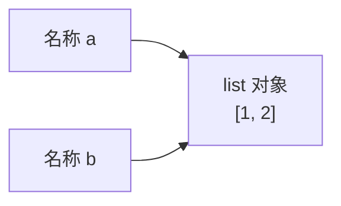

# Day 2：Python 对象模型与可变性

> **课程定位**：面向具有 10 年以上 C++ / Java 经验的高级工程师。目标不是学习 Python 语法，而是建立一套可用于**工程设计、代码评审、故障定位和 LLM 推理框架源码阅读**的对象模型。

本课程承接 `mini-infer` 路线：通过 `SamplingConfig → InferenceRequest → GenerationResult` 三类对象，建立“**配置、输入、运行时状态、输出**”之间清晰的所有权边界。

---

## 0. 建议课程安排

| 阶段 | 时间 | 内容 |
|---|---:|---|
| 概念建模 | 35 分钟 | 对象、名称、引用、身份、相等性 |
| 现场实验 | 30 分钟 | `id()`、别名、函数调用、浅拷贝 |
| 工程设计 | 45 分钟 | mini-infer 三类领域对象 |
| 测试驱动 | 40 分钟 | pytest 验证所有权和隔离性 |
| 源码映射 | 30 分钟 | PyTorch / Transformers / vLLM |
| 面试与复盘 | 20 分钟 | 高频问题、追问与知识图谱 |

---

# 1. 学习目标

完成本课后，学员应当能够：

1. 解释 Python 中为什么“变量”更准确地说是**名称绑定**。
2. 区分对象身份、对象值、对象可变性和名称重新绑定。
3. 预测函数调用之后，调用方对象是否会被修改。
4. 识别默认可变参数、浅拷贝、嵌套可变数据等隐式共享状态。
5. 设计清晰的对象所有权：配置是稳定快照，Request 是请求输入，RequestState 是执行过程状态，Result 是最终输出快照。
6. 阅读 PyTorch、Transformers、vLLM 源码时，主动追问：当前名称指向哪个对象、谁拥有它、谁可以修改它、修改是否会被其他请求观察到，以及复制的究竟是什么。

## 1.1 为什么对象模型对 Python 工程至关重要

大量 Python 工程故障看似是“值被莫名修改”，本质通常是：

- 两个名称绑定到同一个可变对象；
- 只复制了外层容器；
- 构造函数保存了调用方传入的可变列表；
- 默认参数在函数定义时只创建一次；
- “不可变”对象内部仍持有可变对象；
- 配置对象在请求执行中被原地归一化；
- 多个请求共享运行时列表、缓存或处理器实例；
- 将模型别名误认为模型副本。

对 LLM 推理系统而言，这些问题可能表现为请求间 stop token 污染、scheduler 修改 API 输入、beam 候选共享 token history、多个请求共享有状态 logits processor，以及 `model2 = model1` 后两个名称观察到同一模型状态。

## 1.2 与 C++ / Java 对象模型的核心差异

| 维度 | Python | C++ | Java |
|---|---|---|---|
| 名称/变量 | 名称动态绑定到对象 | 变量通常对应类型化存储位置 | 基本类型存值，对象变量存引用 |
| 类型归属 | 对象有类型，名称本身没有固定运行时类型 | 变量具有静态类型 | 变量具有静态声明类型 |
| 赋值 | 默认建立另一条对象引用 | 可能值复制、移动或指针复制 | 对象赋值通常复制引用 |
| 参数传递 | call by sharing | 值、引用、指针均可显式表达 | 对象引用本身按值传递 |
| 生命周期 | 通常由垃圾回收机制管理 | 可确定性析构或手工管理 | GC |
| `is` | 对象身份 | 近似地址/指针身份，但不完全等价 | 近似对象引用的 `==` |
| `==` | 相等性协议 | 运算符可重载 | 对象逻辑值通常由 `equals()` 比较 |

对 C++ 工程师，`b = a` 不应理解为复制构造；对 Java 工程师，Python 的引用语义较熟悉，但 Python 名称可重新绑定到不同类型对象，并大量使用 list、dict 等结构化可变数据。

---

# 2. 核心原理

## 2.1 Name Binding：名称绑定

### 原理

Python 的核心关系是“名称 → 对象”，而不是“变量盒子 → 值”。

```python
a = [1, 2]
b = a
```



`b = a` 没有复制列表。`a = new_object` 是重新绑定，`a.append(...)` 是修改对象。

### 示例

```python
tokens = [101, 102]
request_tokens = tokens
request_tokens.append(103)

assert tokens == [101, 102, 103]
assert request_tokens is tokens
```

```python
tokens = [101, 102]
request_tokens = tokens
request_tokens = request_tokens + [103]

assert tokens == [101, 102]
assert request_tokens == [101, 102, 103]
assert request_tokens is not tokens
```

### 常见坑

```python
def normalize(token_ids: list[int]) -> None:
    token_ids = list(dict.fromkeys(token_ids))
```

这只重新绑定局部名称，调用者看不到结果。如果写成切片赋值，则修改原对象。

### 工程实践建议

- API 名称应体现是否原地修改，如 `normalize()` 与 `normalize_in_place()`。
- 不要让函数既修改输入又返回意义模糊的结果。
- Code review 时区分重新绑定、属性赋值、索引赋值和容器原地操作。
- 阅读源码时画“名称—对象—所有者”关系。

## 2.2 `is` 与 `==`

### 原理

- `a is b`：是否为同一个对象。
- `a == b`：是否满足类型定义的相等性协议。

### 示例

```python
a = [1, 2]
b = [1, 2]
c = a

assert a == b
assert a is not b
assert a == c
assert a is c
```

### 常见坑

- 不要用 `is` 比较数字、字符串或业务枚举值。
- 对 `None` 使用 `is None`。
- Tensor 的 `==` 常返回逐元素布尔 Tensor，应按意图使用 `torch.equal()` 或 `torch.allclose()`。

### 工程实践建议

测试隔离性时同时验证：

```python
assert copied == original
assert copied is not original
```

## 2.3 Mutable 与 Immutable

### 原理

可变对象可在身份不变时修改内部状态。典型可变对象包括 list、dict、set、普通类实例、Tensor 和 nn.Module。典型不可变对象包括 int、float、str、bytes、tuple 和 frozenset。

但 tuple 的结构不可变，不代表它引用的整个对象图不可变：

```python
config = (0.8, [1, 2])
config[1].append(3)
assert config == (0.8, [1, 2, 3])
```

### 常见坑

`frozen=True` 只阻止普通字段重新赋值，不会自动冻结内部 list：

```python
from dataclasses import dataclass

@dataclass(frozen=True)
class BadConfig:
    stop_token_ids: list[int]
```

### 工程实践建议

```python
@dataclass(frozen=True, slots=True)
class SamplingConfig:
    stop_token_ids: tuple[int, ...] = ()
```

| 对象 | 推荐可变性 | 原因 |
|---|---|---|
| SamplingConfig | 不可变 | 稳定策略快照 |
| InferenceRequest | 尽量不可变 | API 输入应稳定 |
| RequestState | 可变 | token、阶段、缓存持续变化 |
| GenerationResult | 不可变 | 输出是完成时快照 |
| KV cache storage | 可变 | decode 每步写入 |
| Scheduler queues | 可变 | 请求不断迁移 |

## 2.4 Pass-by-Object-Reference / Call by Sharing

### 原理

函数调用时，形参名称绑定到实参当前引用的对象。函数可以修改共享的可变对象，但不能通过重新绑定形参来改变调用方名称的绑定。


注释：

函数调用时，形参和实参名称指向同一个对象。

修改共享的可变对象（如 append）会影响调用方；

重新给形参赋值只改变局部绑定，不影响调用方变量。

```python
def append_eos(token_ids: list[int]) -> None:
    token_ids.append(2)


tokens = [100, 200]
append_eos(tokens)
assert tokens == [100, 200, 2]
```
list 是可变对象，append() 修改原来的 list。它没有让 token_ids 指向另一个 list，而是改变了两个名称共同引用的对象。

进入函数:
```python
tokens ───────┐
              ↓
        list A [100, 200]
              ↑
token_ids ────┘
```
执行 token_ids.append(2)

```python
tokens ───────┐
              ↓
           list A [100, 200, 2]
              ↑
token_ids ────┘
```
变化的是 list A 的内部内容.这就是：函数可以修改共享的可变对象。

同样的情况也适用于 dict、set、普通类实例、PyTorch Tensor 和 nn.Module 等可变对象。

### 重新绑定形参对调用方不可见

```python
def replace_tokens(token_ids: list[int]) -> None:
    token_ids = [2]


tokens = [100, 200]
replace_tokens(tokens)
assert tokens == [100, 200]
```

token_ids = [2] 它没有修改原来的 list，而是：
1.创建一个新 list [2]；

2.将函数局部名称 token_ids 重新绑定到新 list；

3.调用方名称 tokens 仍然绑定到原 list

执行 token_ids = [2] 后

``` python
tokens ─────────> list A [100, 200]
token_ids ──────> list B [2]
```
token_ids 和 tokens 是两个不同作用域中的名称。改变 token_ids 的绑定，不会改变 tokens 的绑定

不能通过重新绑定形参来改变调用方名称的绑定.


### 不可变对象表现如何
考虑整数：
``` python
def increment(value: int) -> None:
    value += 1


count = 10
increment(count)

assert count == 10

```
int 是不可变对象，不能原地把整数对象 10 改成 11。

字符串和 tuple 也类似：
``` python
def add_suffix(text: str) -> None:
    text += " world"


message = "hello"
add_suffix(message)

assert message == "hello"

```
特别指出，tuple 的结构不可变，但它引用的整个对象图**不一定**不可变。

```python
def update_config(config: tuple[float, list[int]]) -> None:
    config[1].append(3)


sampling = (0.8, [1, 2])
update_config(sampling)

assert sampling == (0.8, [1, 2, 3])
```
对象关系：

``` python
sampling ──> tuple
             ├──> float 0.8
             └──> list [1, 2]
                       ↑
函数通过 config[1] 修改这个 list
```


### 工程实践建议

API 边界可采用只读协议、入口快照或显式所有权转移：

```python
from collections.abc import Sequence

def submit(token_ids: Sequence[int]) -> tuple[int, ...]:
    return tuple(token_ids)
```

## 2.5 Shallow Copy 与 Deep Copy

### 原理

浅拷贝创建新的外层容器，但内部对象仍共享；深拷贝尝试递归复制对象图。

```python
import copy

original = {
    "stop_token_ids": [1, 2],
    "metadata": {"tenant": "A"},
}

shallow = copy.copy(original)
deep = copy.deepcopy(original)
shallow["stop_token_ids"].append(3)

assert original["stop_token_ids"] == [1, 2, 3]
assert deep["stop_token_ids"] == [1, 2]
```

### 常见坑

- `dict.copy()` 只复制一层。
- `deepcopy` 不理解所有业务所有权。
- GPU Tensor、锁、future、文件句柄、tokenizer 和自定义扩展对象未必适合深拷贝。

### 工程实践建议

优先设计不可变值对象；用 `dataclasses.replace()` 创建配置变体；按字段有意复制；仅在对象图语义明确时使用 `deepcopy`。

## 2.6 默认可变参数陷阱

### 原理

默认参数表达式在函数定义执行时求值，而不是每次调用时求值。

```python
def bad_add(token_id: int, stops: list[int] = []) -> list[int]:
    stops.append(token_id)
    return stops
```

正确写法：

```python
def add_stop(
    token_id: int,
    stops: list[int] | None = None,
) -> list[int]:
    owned_stops = [] if stops is None else list(stops)
    owned_stops.append(token_id)
    return owned_stops
```

### 工程实践建议

- 默认值优先使用 `None`、数字、字符串和 tuple。
- 接受外部 list 后，按所有权策略复制或转为 tuple。
- 缓存应使用具名对象或标准缓存机制，不应隐藏在默认参数中。

## 2.7 dataclass 与 `default_factory`

```python
from dataclasses import dataclass, field

@dataclass
class RequestState:
    generated_token_ids: list[int] = field(default_factory=list)
    events: list[str] = field(default_factory=list)
```

factory 在每次实例化时调用。

常见错误：

```python
field(default_factory=list())  # 错误：传入了对象
```

正确：

```python
field(default_factory=list)
```

运行时状态适合 `field(default_factory=list)`；不可变配置适合 tuple。

---

# 3. mini-infer 实战


## 3.1 推荐实现

```python
# src/mini_infer/config.py
from __future__ import annotations

import math
from dataclasses import dataclass, field


@dataclass(frozen=True, slots=True)
class SamplingConfig:
    temperature: float = 1.0
    max_tokens: int = 32
    top_k: int | None = None
    stop_token_ids: tuple[int, ...] = field(default_factory=tuple)
    seed: int | None = None

    def __post_init__(self) -> None:
        if not math.isfinite(self.temperature):
            raise ValueError("temperature must be finite")
        if self.temperature < 0.0:
            raise ValueError("temperature must be >= 0")
        if self.max_tokens < 0:
            raise ValueError("max_tokens must be >= 0")
        if self.top_k is not None and self.top_k <= 0:
            raise ValueError("top_k must be positive or None")

        normalized_stops = tuple(dict.fromkeys(self.stop_token_ids))
        if any(isinstance(x, bool) or not isinstance(x, int)
               for x in normalized_stops):
            raise TypeError("stop_token_ids must contain integers")
        if any(x < 0 for x in normalized_stops):
            raise ValueError("stop token IDs must be non-negative")

        object.__setattr__(self, "stop_token_ids", normalized_stops)
```

```python
# src/mini_infer/engine/request.py
from dataclasses import dataclass, field
from enum import Enum, auto
from types import MappingProxyType
from typing import Mapping
from uuid import uuid4


class RequestPhase(Enum):
    WAITING = auto()
    PREFILL = auto()
    DECODING = auto()
    FINISHED = auto()
    FAILED = auto()


@dataclass(frozen=True, slots=True)
class InferenceRequest:
    prompt: str
    sampling: SamplingConfig = field(default_factory=SamplingConfig)
    request_id: str = field(default_factory=lambda: uuid4().hex)
    metadata: Mapping[str, str] = field(default_factory=dict)

    def __post_init__(self) -> None:
        if not self.prompt:
            raise ValueError("prompt must not be empty")
        object.__setattr__(
            self,
            "metadata",
            MappingProxyType(dict(self.metadata)),
        )


@dataclass(slots=True)
class RequestState:
    request: InferenceRequest
    phase: RequestPhase = RequestPhase.WAITING
    prompt_token_ids: list[int] = field(default_factory=list)
    generated_token_ids: list[int] = field(default_factory=list)
    finish_reason: str | None = None
    error: Exception | None = None

    def append_token(self, token_id: int) -> None:
        if self.phase is RequestPhase.FINISHED:
            raise RuntimeError("cannot append token to finished request")
        self.generated_token_ids.append(token_id)

    def finish(self, reason: str) -> None:
        self.finish_reason = reason
        self.phase = RequestPhase.FINISHED
```

```python
# src/mini_infer/outputs.py
from dataclasses import dataclass


@dataclass(frozen=True, slots=True)
class GenerationResult:
    request_id: str
    text: str
    token_ids: tuple[int, ...]
    finish_reason: str

    @classmethod
    def from_state(
        cls,
        state: RequestState,
        text: str,
    ) -> "GenerationResult":
        if state.finish_reason is None:
            raise ValueError("request is not finished")
        return cls(
            request_id=state.request.request_id,
            text=text,
            token_ids=tuple(state.generated_token_ids),
            finish_reason=state.finish_reason,
        )
```

## 3.2 为什么配置对象适合不可变

不可变配置提供配置隔离、可解释性、测试稳定性、共享安全性和失败原子性。配置变体应显式创建：

```python
from dataclasses import replace

greedy = replace(base_config, temperature=0.0)
```

## 3.3 为什么运行时状态适合可变

请求状态在 WAITING、PREFILL、DECODING、FINISHED/FAILED 之间迁移，同时持续更新 token、cache block、统计和完成原因。每步都复制完整状态会增加对象分配、token history 复制和 GC 压力。

> **可变性不是坏事；无边界、无所有者、无不变量的共享可变性才是坏事。**

---

# 4. pytest 测试设计

```python
# tests/unit/test_object_model.py
import copy
from dataclasses import FrozenInstanceError, replace

import pytest
```

## 4.1 验证默认参数不共享

```python
def test_request_states_do_not_share_generated_tokens() -> None:
    request = InferenceRequest(prompt="hello")
    first = RequestState(request=request)
    second = RequestState(request=request)

    first.generated_token_ids.append(42)

    assert first.generated_token_ids == [42]
    assert second.generated_token_ids == []
    assert first.generated_token_ids is not second.generated_token_ids
```

## 4.2 验证配置隔离

```python
def test_sampling_config_snapshots_input_sequence() -> None:
    external_stops = [2, 3]
    config = SamplingConfig(stop_token_ids=tuple(external_stops))

    external_stops.append(4)

    assert config.stop_token_ids == (2, 3)
```

## 4.3 验证拷贝行为

```python
def test_shallow_copy_shares_nested_list() -> None:
    original = {"sampling": {"stop_token_ids": [2, 3]}}
    copied = copy.copy(original)
    copied["sampling"]["stop_token_ids"].append(4)

    assert original["sampling"]["stop_token_ids"] == [2, 3, 4]


def test_deep_copy_duplicates_nested_list() -> None:
    original = {"sampling": {"stop_token_ids": [2, 3]}}
    copied = copy.deepcopy(original)
    copied["sampling"]["stop_token_ids"].append(4)

    assert original["sampling"]["stop_token_ids"] == [2, 3]
    assert copied["sampling"]["stop_token_ids"] == [2, 3, 4]
```

## 4.4 验证 frozen dataclass

```python
def test_sampling_config_is_frozen() -> None:
    config = SamplingConfig(temperature=0.8)

    with pytest.raises(FrozenInstanceError):
        config.temperature = 0.2  # type: ignore[misc]


def test_replace_creates_new_config() -> None:
    original = SamplingConfig(temperature=0.8)
    greedy = replace(original, temperature=0.0)

    assert original.temperature == 0.8
    assert greedy.temperature == 0.0
    assert greedy is not original
```

## 4.5 验证结果是状态快照

```python
def test_result_does_not_track_later_state_mutation() -> None:
    request = InferenceRequest(prompt="hello")
    state = RequestState(request=request, phase=RequestPhase.DECODING)
    state.generated_token_ids.extend([10, 20])
    state.finish("stop")

    result = GenerationResult.from_state(state, text="hello world")
    state.generated_token_ids.append(30)

    assert result.token_ids == (10, 20)
    assert state.generated_token_ids == [10, 20, 30]
```

---

# 5. vLLM、Transformers 与 PyTorch 实践

## 5.1 SamplingParams 设计思想

不要把真实框架的 SamplingParams 简化为“immutable dataclass”。生产实现通常还承担参数校验、归一化、派生字段、停止条件、采样类型、tokenizer 更新和定制 clone 行为。

应重点学习：

1. API 配置是领域对象，而不是无约束字典。
2. 外部输入形式与内部执行形式可能不同。
3. clone 不一定等价于无条件 `deepcopy`。
4. 扩展处理器可能有状态，也可能不应机械复制。

mini-infer 初期采用严格不可变配置，以强化所有权、请求隔离和可测试性。

## 5.2 Engine 与 Request State

```text
Request specification
    prompt + sampling params
              ↓
Engine-owned request state
    token ids + status + cache metadata
              ↓
Per-iteration scheduled batch
              ↓
Model runner inputs
              ↓
Updated request state
```

源码阅读时应追问：哪一步复制或归一化配置、谁补充 EOS、状态是否跨线程或进程、scheduler 持有什么对象、输出是否为独立快照，以及请求完成后哪些资源被释放。

## 5.3 `nn.Module` 引用语义

```python
model2 = model1
```

只创建另一个名称，两个名称指向同一个 `nn.Module`，并共享子模块、Parameter、buffer 以及 train/eval 状态。

```python
assert model2 is model1
assert next(model2.parameters()) is next(model1.parameters())
```

如果需要权重相同但独立的模型，应显式重建结构并加载状态：

```python
model2 = TinyModel(config)
model2.load_state_dict(model1.state_dict())

for p1, p2 in zip(model1.parameters(), model2.parameters()):
    assert p1 is not p2
    assert torch.equal(p1, p2)
```

Tensor 还需要区分对象身份、底层 storage、view、autograd 图和 clone：

- `y = x`：同一 Tensor 对象；
- `y = x.view(...)`：不同 Tensor 对象，可能共享 storage；
- `y = x.detach()`：改变 autograd 关系，但可能共享 storage；
- `y = x.clone()`：复制数据，通常产生独立 storage。

---

# 6. 面试专题

## 6.1 Python 到底是传值还是传引用？

**标准答案**：更准确地说是 call by sharing / pass by assignment。形参绑定到实参引用的对象。函数可修改共享可变对象，但重新绑定形参不会改变调用方名称。

**追问点**：`append` 与 `x = x + [...]` 的区别；tuple 内含 list 是否不可变；如何设计不污染输入的 API。

## 6.2 `is` 和 `==` 有什么区别？

**标准答案**：`is` 比较身份，`==` 比较逻辑值；`None` 使用 `is None`；不能依赖整数或字符串驻留。

## 6.3 frozen dataclass 是否完全不可变？

**标准答案**：不是。它主要阻止字段重新赋值，不会递归冻结字段引用的对象。深层不可变需要选择 tuple、frozenset 和不可变值对象。

## 6.4 浅拷贝与深拷贝区别是什么？

**标准答案**：浅拷贝只创建新的外层对象，嵌套对象仍共享；深拷贝递归复制对象图，但不保证外部资源和框架扩展对象符合预期业务语义。

## 6.5 默认可变参数为什么危险？

**标准答案**：默认表达式在函数定义时执行一次，省略参数的后续调用复用同一对象，从而导致跨调用共享状态。

## 6.6 为什么配置对象适合 immutable？

**标准答案**：配置是请求策略快照。不可变性提高隔离性、可测试性、可解释性与共享安全性。

## 6.7 `model2 = model1` 后发生了什么？

**标准答案**：两个名称绑定到同一个 Module；没有创建新模型，没有复制 Parameter、buffer 或 optimizer state。

## 6.8 架构排障题

如果请求 A 的 stop token 偶发影响请求 B：

1. 检查函数默认参数中的 list/dict/set；
2. 检查 dataclass 字段是否共享；
3. 检查 class attribute 是否保存请求状态；
4. 检查配置 clone 是浅拷贝还是深拷贝；
5. 检查 Engine 是否修改调用方列表；
6. 检查 pytest fixture scope；
7. 用身份断言定位共享对象；
8. 增加测试顺序无关性；
9. 将配置字段转换为 tuple；
10. 将执行状态下沉到每请求独立的 RequestState。

---

# 7. 一页总结

## 7.1 核心知识图谱

```mermaid
flowchart TD
    A["Python 对象模型"] --> B["名称绑定"]
    A --> C["对象身份与相等"]
    A --> D["可变性"]
    A --> E["调用语义"]
    A --> F["复制语义"]
    A --> G["所有权设计"]

    B --> B1["赋值通常不复制对象"]
    B --> B2["重新绑定 ≠ 修改对象"]
    C --> C1["is：身份"]
    C --> C2["==：值相等协议"]
    C --> C3["None 使用 is"]
    D --> D1["list / dict / set 可变"]
    D --> D2["tuple 仅外层结构不可变"]
    D --> D3["frozen 不是深度冻结"]
    E --> E1["形参绑定到实参对象"]
    E --> E2["可修改共享可变对象"]
    E --> E3["重绑定不改变调用方名称"]
    F --> F1["浅拷贝：复制外层"]
    F --> F2["深拷贝：递归对象图"]
    F --> F3["deepcopy 不等于正确所有权"]
    G --> G1["Config：不可变快照"]
    G --> G2["Request：稳定输入"]
    G --> G3["State：受控可变"]
    G --> G4["Result：不可变输出"]
    G --> G5["Model alias：共享参数"]
```



## 7.2 易错点 Top 10

1. 把 `b = a` 当成对象复制。
2. 用 `is` 比较整数、字符串或业务值。
3. 认为 tuple 内部所有对象都不可变。
4. 认为 `frozen=True` 会递归冻结字段。
5. 使用默认参数 `items=[]`。
6. 使用 `dict.copy()` 后误以为嵌套对象已隔离。
7. 用 `deepcopy()` 代替所有权设计。
8. 构造配置时直接保存调用方的 list。
9. 把 Request 配置和 RequestState 混在一个对象中。
10. 认为 `model2 = model1`、Tensor view 或 detach 等价于独立数据副本。

## 7.3 核心记忆口诀

> **名绑对象，不装值；**  
> **赋值别名，不复制；**  
> **is 看身份，等号比值；**  
> **改对象可见，改绑定无知；**  
> **浅拷外壳，深拷对象图；**  
> **默认可变，跨调用共持；**  
> **配置冻结，状态独占；**  
> **结果快照，边界清晰；**  
> **模型赋值，只增别名；**  
> **先问所有权，再谈可变性。**

---

# 8. 本日验收标准

完成课程后，应能回答：

- `a = b` 是否创建新对象？
- `append()` 与重新赋值为什么行为不同？
- Python 参数传递如何准确描述？
- frozen dataclass 为什么仍可能可变？
- `default_factory` 解决了什么、不解决什么？
- 浅拷贝为什么可能造成请求间污染？
- 如何设计不可变 SamplingConfig？
- 为什么 RequestState 应保持可变？
- Result 为什么必须复制 token history？
- `model2 = model1` 为什么不是模型副本？

验收命令：

```bash
python -m pytest tests/unit/test_object_model.py -v
python -m mypy src
python -m ruff check .
```

最终工程判断标准：

> **一个对象可以可变，但必须能够明确回答：谁拥有它、谁能修改它、修改会被谁观察到，以及何时把它冻结为快照。**
